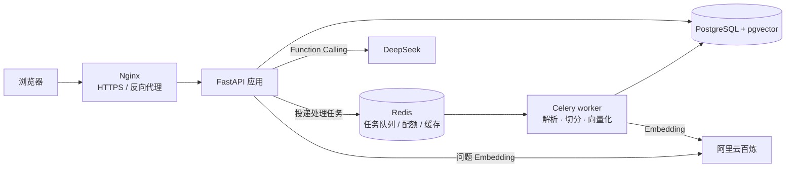
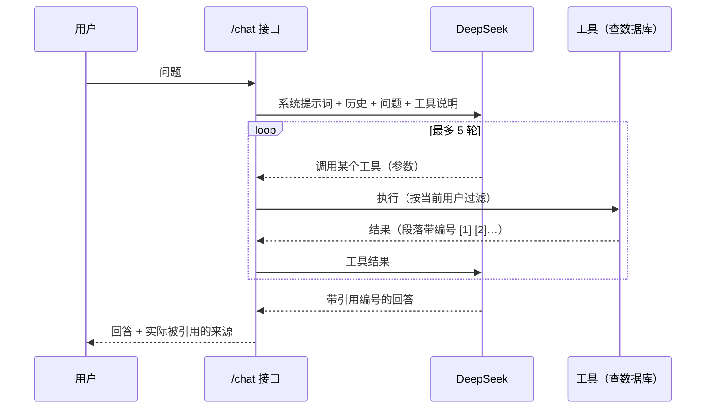

# 多用户 RAG 知识库问答系统

[](https://github.com/Chraining/rag-knowledge/actions/workflows/test.yml)

用户注册登录后上传自己的文档，后台异步完成解析、切分和向量化；之后用自然语言提问，由 **Agent** 自主调用检索等工具查找资料，给出**带引用来源**的回答。每个用户只能看到、检索到自己的文档。

在线体验：<https://rag.chrain.me>

## 功能

- **Agent 问答**：大模型通过 Function Calling 自主选择 `search_documents`（语义检索）、`list_documents`（列出文档）、`read_document`（通读文档）三个工具，可多轮调用。能回答"我上传了几个文件""对比 A 和 B 两份文档""总结一下这个文件"这类单次检索答不好的问题。
- **多格式文档**：PDF、Word、PowerPoint（含演讲者备注）、Excel、CSV、HTML、Markdown、TXT（支持 GBK 编码）。
- **多轮对话**：会话管理，追问时带上最近的历史消息。
- **多用户隔离**：JWT 认证；所有查询和向量检索都在 SQL 里按用户过滤。
- **配额与降级**：每日提问配额（Redis 计数，Redis 故障时回退数据库计数）；大模型不可用时返回 503 并退还配额。
- **简易前端**：单页面，原生 JavaScript，由后端直接托管。

## 架构



**上传**：接口校验文件（扩展名、文件魔数、解压后大小），保存文件，写入一条 `pending` 记录，投递 Celery 任务后立即返回（约 0.1 秒）。worker 在后台提取文字、切分、调用 Embedding，最后在一个事务里写入全部段落并把状态改为 `ready`。

**提问**：



## 技术栈

Python 3.13 · FastAPI · SQLAlchemy 2.0 · Alembic · PostgreSQL 18 + pgvector（HNSW）· Redis · Celery · Docker Compose · Nginx · DeepSeek（对话 + Function Calling）· 阿里云百炼 text-embedding-v4 · pytest · GitHub Actions

## 关键设计

| 问题 | 做法 | 代码 |
|---|---|---|
| 模型会不会读到别人的文档 | 模型只能选择"调用哪个工具、传什么参数"，每个工具都在 SQL 里按当前用户过滤，传入别人的文档 id 也查不到 | [`app/agent.py`](app/agent.py)、[`app/queries.py`](app/queries.py) |
| Agent 停不下来、费用失控 | 最多 5 轮工具调用，之后用 `tool_choice="none"` 强制回答 | [`app/agent.py`](app/agent.py) |
| 模型生成的工具参数格式不对 | 不抛异常，把错误作为工具结果返回给模型，让它改正后重试 | [`app/agent.py`](app/agent.py) |
| 来源不准确 | 多轮检索统一编号，只把回答里实际引用了的段落作为来源 | [`app/agent.py`](app/agent.py) |
| 多用户共用 HNSW 索引，过滤后结果不够 | 开启 pgvector 的 `iterative_scan`，过滤后不够数就继续在索引里找 | [`app/queries.py`](app/queries.py) |
| 检索到的段落其实不相关 | 相似度低于 0.3 的段落丢弃（按实测：相关约 0.55–0.67，无关约 0.12–0.19） | [`app/config.py`](app/config.py) |
| 后台任务重复执行 | 行锁 + 先删后写 + `(document_id, chunk_index)` 唯一约束，执行几次结果都一样 | [`app/processing.py`](app/processing.py) |
| 临时错误和永久错误 | 外部服务失败（临时）指数退避重试；文件损坏、扫描版 PDF（永久）直接标记失败 | [`app/tasks.py`](app/tasks.py) |
| 伪装文件、压缩炸弹 | 校验文件魔数；Office 文件检查解压后的总大小 | [`app/extract.py`](app/extract.py) |
| 表格切分后看不懂 | 按整行切分，每行都带列名（`列名: 值`） | [`app/extract.py`](app/extract.py) |
| 调用大模型时占着数据库连接 | 调用前提交事务、归还连接 | [`app/routers/chat.py`](app/routers/chat.py) |

## 排查过的线上问题

- **长文档导致 worker 被杀并循环重试**：500 万字的文档让 worker 超过 400MB 内存上限被系统杀掉；Celery 的 `acks_late` 又把任务重新投递，形成死循环。通过 cgroup `memory.peak` 和内存采样定位到向量用 Python 列表存储（每个约 36KB）、一次性写库。改用 pgvector 的紧凑 `Vector` 类型（约 4KB）并每 200 段分批写入后，峰值内存从被杀降到 **181MB**。测量脚本：[`scripts/measure_memory.py`](scripts/measure_memory.py)。
- **重建应用容器后 502**：Nginx 只在启动时解析一次 `app` 的 IP，容器重建换了 IP 后还在访问旧地址。改为通过 Docker 内置 DNS（`127.0.0.11`）动态解析。见 [`docker/nginx.conf`](docker/nginx.conf)。

## 检索评测

用两份评测集衡量检索效果，脚本 [`scripts/evaluate.py`](scripts/evaluate.py)：

- **自建评测集**：10 份虚构公司的文档（制度、说明书、故障代码表、会议纪要、价格表），52 个问题，分为关键词类（型号、代码）和语义类（换了说法的问题），见 [`eval/`](eval/)。
- **DuRetrieval 子集**：百度发布的公开中文检索数据集（C-MTEB），抽取 300 个真实搜索查询和 1 万段网页段落，见 [`scripts/build_duretrieval.py`](scripts/build_duretrieval.py)。

指标：Recall@5（相关段落有多少进了前 5，线上只把前 5 段交给模型）、MRR（第一个相关段落排名的倒数的平均值）。

**混合检索和重排序都做了、测了，线上仍只用向量检索：**

| 检索方式 | DuRetrieval Recall@5 | DuRetrieval MRR | 自建 Recall@5 | 自建 MRR |
|---|---|---|---|---|
| 向量（线上使用） | **80.5%** | **0.977** | **100%** | **0.842** |
| 关键词（jieba + 带 IDF 的 BM25 式打分） | 60.8% | 0.861 | 90.4% | 0.745 |
| 混合（RRF 融合） | 75.9% | 0.944 | 94.2% | 0.828 |
| 向量前 20 段 + 重排序（qwen3-rerank） | 79.6% | 0.967 | 100% | **0.968** |

- 关键词检索：jieba 分词后存进 PostgreSQL 的 `tsvector` 列（GIN 索引）。PostgreSQL 自带的 `ts_rank` 只看词频、没有 IDF，常见词会淹没型号这类关键词；离线实测只用 `ts_rank` 的 Recall@5 只有 26.7%，补上 IDF 后为 60.8%，和标准 BM25（60.5%）相当。见 [`app/queries.py`](app/queries.py)。
- 混合检索更差的原因：text-embedding-v4 已经很强，关键词这一路明显更弱，RRF 融合时把好的向量结果挤出了前 5；给关键词降低权重（0.25–0.75）也都不如纯向量。关键词检索也几乎找不到新的相关段落：向量前 20 名已覆盖 97.1%，加上关键词结果（共约 33 段）为 97.8%，和直接取向量前 40 名相同。
- 重排序在自建评测集上明显有效：正确段落排第一的比例（Recall@1）从 73.1% 提高到 94.2%，MRR 从 0.842 提高到 0.968。但 Recall@5 本来就是 100%，线上把前 5 段都交给模型，回答几乎不变，所以没有上线（每次检索还要多花约 0.005 元、多等约 0.5–1 秒）。
- 重排序在 DuRetrieval 上持平：34 个查询变好、31 个变差。逐条查看，变差的一部分是重排序真的排错了（被"娃娃""霜"这类字面相同的词误导），一部分是它排上来的段落确实相关、只是数据集没有标注。公开数据集的标注不完整，排序上的小差别会被标注噪声淹没。
- 什么时候值得上线重排序：知识库更大、向量检索的 Recall@5 明显低于 100% 时；或者想只给模型 3 段以缩短提示词时（加重排序后自建评测集的 Recall@3 从 92.3% 提高到 100%）。

## 本地运行

需要 Docker 和 [uv](https://docs.astral.sh/uv/)，以及 DeepSeek 和阿里云百炼的 API key。

### 方式一：全部用 Docker 运行

```bash
cp .env.example .env    # 填入 DEEPSEEK_API_KEY 和 DASHSCOPE_API_KEY
docker compose up -d --build
```

打开 <http://127.0.0.1>。启动时会自动执行数据库迁移。

### 方式二：只用 Docker 跑数据库，代码在本机运行（开发用）

```bash
cp .env.example .env    # 填入两个 API key
docker compose up -d postgres redis
uv sync
uv run alembic upgrade head
uv run uvicorn app.main:app --reload                       # 应用：http://127.0.0.1:8000
uv run celery -A app.celery_app worker --pool=solo -l info  # 另开一个终端运行 worker
```

接口文档：<http://127.0.0.1:8000/docs>

## 测试

```bash
docker compose up -d postgres
uv run pytest
```

共 139 个测试，覆盖权限隔离、Agent 工具与循环上限、任务幂等、配额与降级、文件格式与安全校验等。测试使用真实的 PostgreSQL（独立的 `rag_test` 库，每个测试在事务里运行后回滚），AI 服务和 Redis 换成假的，不联网、不花钱。每次推送由 GitHub Actions 自动运行。

## 项目结构

```
app/
  agent.py          Agent：工具定义、工具调用循环、引用编号
  routers/          接口：认证、文档、问答、会话、健康检查
  queries.py        所有查询（按用户过滤）、向量检索、关键词检索和混合检索
  processing.py     文档处理：提取 → 切分 → 向量化 → 入库（幂等）
  extract.py        各格式的文字提取与安全校验
  tasks.py          Celery 任务：重试策略
  llm.py            调用 DeepSeek 和百炼：对话、embedding、重排序（超时、重试、统一错误）
  rag.py            问题向量（Redis 缓存）
  segment.py        中文分词（jieba），给关键词检索用
  quota.py          每日配额
  models.py         数据表
alembic/            数据库迁移
frontend/           单页面前端
docker/             Nginx 配置、数据库初始化脚本
scripts/            检索评测、造数据、EXPLAIN 分析、内存测量等脚本
eval/               自建检索评测集
tests/              pytest 测试
```

## 局限

- 扫描版 PDF 和图片需要 OCR，目前不支持。
- 只按字数切分，没有按章节结构切分。
- 自建评测集只有 22 段，向量检索已经饱和（Recall@5 = 100%），区分不出更细的改进；也还没有评测回答本身是否正确。
- 每个问题至少调用一次大模型，一般 2–3 次，比固定的"检索一次再回答"更慢、更贵。
